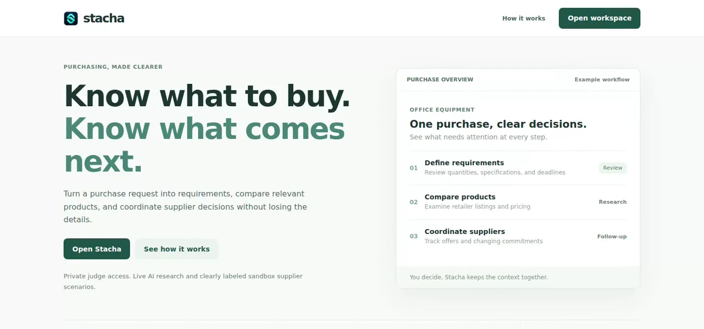
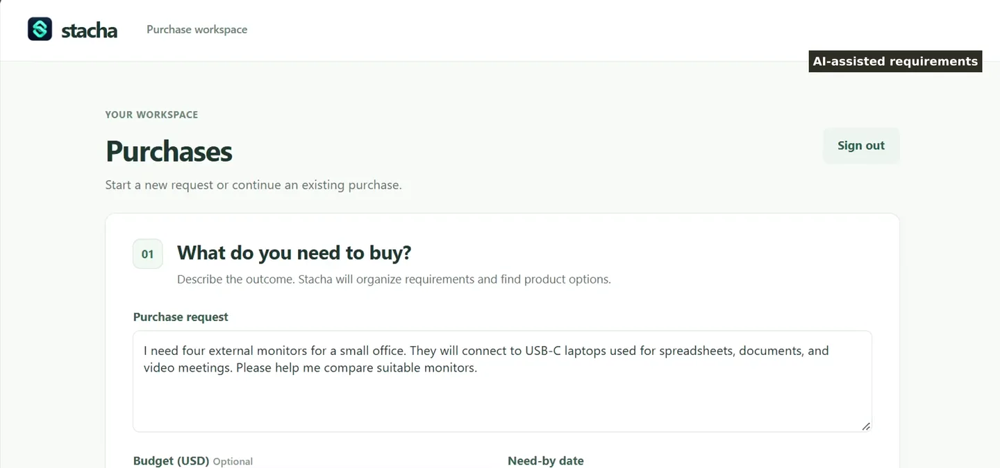
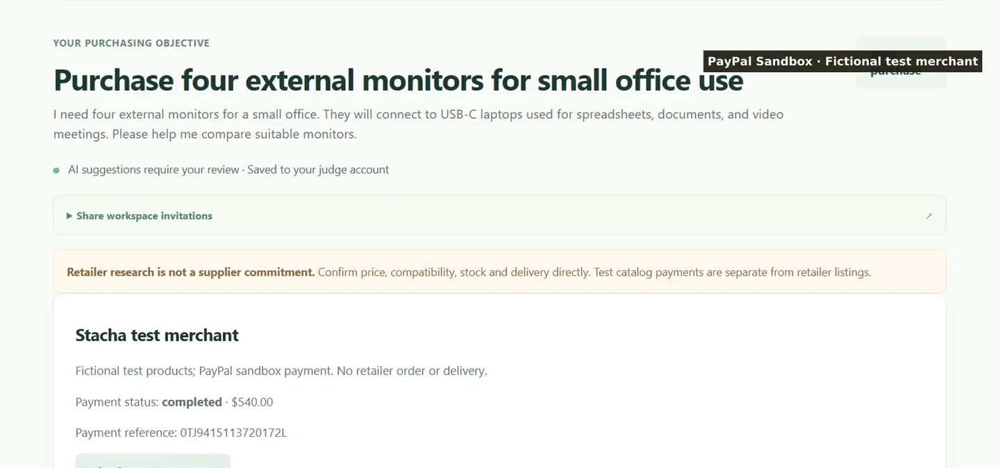
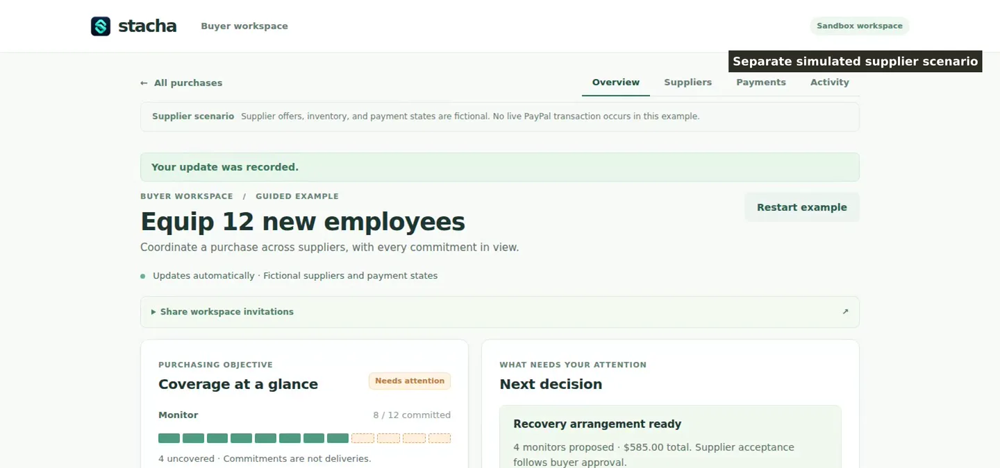
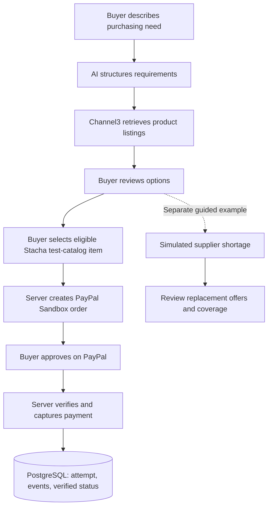

<div align="center">
  

  # Stacha

  **Know what to buy. Know what comes next.**

  An AI-assisted purchasing workspace for turning a business need into a reviewable plan, researching products, and completing verified PayPal Sandbox payments.

  [**Try the live demo**](https://stacha-hackathon-demo.onrender.com/) · [**Explore the code**](https://github.com/getstacha/stacha) · [**PayPal AI Hackathon**](https://paypalaihackathon.devpost.com/)

  `PayPal Sandbox` · `AI-assisted procurement` · `Channel3 product research` · `Node.js` · `PostgreSQL` · `Render`
</div>



> **Judge access:** Open the [hosted workspace](https://stacha-hackathon-demo.onrender.com/app) and enter the private access code supplied with the hackathon submission. Each new redemption of the reusable code creates an isolated workspace. Keep the browser session to return to the same purchases; signing in again with the shared code starts a new workspace. No real money or physical products are involved in Sandbox checkout.

## Why Stacha?

A purchase often starts with an outcome: *equip a new team, replace office hardware, or solve an operational need*. The exact product, specifications, and supplier may still be unclear.

Stacha helps buyers move through that process without losing the context behind each decision:

1. **Describe the need** in ordinary language, with a budget and deadline.
2. **Review AI-suggested requirements**—quantities, specifications, and questions that still need answers.
3. **Research actual listings** through Channel3, with retailer links and a suggested purchase plan.
4. **Test checkout with PayPal Sandbox**, using a clearly identified fictional Stacha merchant catalog.
5. **Explore supplier disruption and recovery** in a separate, explicitly simulated scenario.

The buyer decides what to purchase. Suggestions, product availability, compatibility, and supplier terms remain subject to review.

**Designed for:** small teams, office managers, and operations buyers who have a clear outcome and need help translating it into a purchase. Stacha keeps the original request, product evidence, buyer decisions, and payment record together so the process can continue after the first search.

## Product walkthrough

### 1. Start with the problem

For example:

> We need four external monitors for a small office. They will connect to USB-C laptops used for spreadsheets, documents, and video meetings. Help us compare suitable options.

Stacha turns that request into structured requirements. The buyer reviews the assumptions and can begin a refined request when the suggestions need changing.



### 2. Compare product evidence

Stacha queries Channel3 for product listings and uses an AI model to prepare a reviewable plan. Results include merchant links, listed prices, and any uncertainty about compatibility, delivery, or stock. The hosted workflow researches up to the first **three** interpreted product requirements per run; additional requirements remain visible for buyer review.


### 3. Verify a PayPal Sandbox payment

For eligible requirements, the buyer can select a fixed-price test product from **Stacha's fictional merchant catalog** and approve checkout on PayPal Sandbox. The checkout shown in the demo used **four test office monitors at $135 each, totaling $540 USD**.

Stacha obtains the order from PayPal, validates the order and merchant details on the server, captures the approved payment, verifies the resulting capture, and stores the attempt and payment events in PostgreSQL. The buyer can reopen the project to see the recorded payment status.



**Payment scope:** The Sandbox test merchant is separate from the real retailer listings returned by Channel3. A test-catalog payment creates no retailer order, shipment, or real-world fulfillment obligation. PayPal may display the buyer's local currency during approval; Stacha records the test purchase in USD.

### 4. Review a supplier disruption

The guided recovery experience models a supplier shortage, uncovered quantities, alternative fictional quotes, and the buyer's recovery decision. It makes the coordination problem visible while keeping the scenario clearly separated from real PayPal operations.



**Simulation scope:** Supplier offers, commitments, and financial recovery actions in this guided example are fictional. The hosted scenario does not execute PayPal refunds, authorization voids, supplier payouts, or replacement purchases.

## How PayPal and AI work together

| Component | Implemented behavior | Why it matters |
| --- | --- | --- |
| **AI — Nebius Token Factory** | Interprets requests into validated structured requirements and purchase-plan suggestions. The default model is `nvidia/Nemotron-3_5-Lightning`, configurable through `NEBIUS_MODEL`. | Helps a buyer turn an incomplete need into concrete options. |
| **Channel3** | Searches live product data and returns normalized retailer offers, links, prices, and reported availability. | Grounds suggestions in discoverable products. |
| **PayPal Orders API v2 (Sandbox)** | Creates orders, redirects buyers for approval, captures payment, and retrieves order/capture status. | Demonstrates an actual transaction through the PayPal developer platform. |
| **Server-side payment verification** | Checks the expected merchant, USD amount, order reference, item details, and successful capture before recording completion. | Keeps the payment decision tied to server-validated evidence. |
| **PostgreSQL** | Persists hosted judge sessions, projects, payment attempts and events, and provider-usage quotas. | Supports a continuous, auditable buyer experience across app restarts. |
| **Render** | Hosts the live web application and PostgreSQL-backed judge workspace. | Makes the functioning prototype accessible for evaluation. |

### Payment sequence



The real retailer research and fictional Sandbox catalog are intentionally separate. The guided supplier scenario uses its own simulated commercial state.

### Payment integrity details

- **Server-calculated terms:** catalog prices and quantities determine the order total; the buyer cannot submit an arbitrary payment amount.
- **PayPal identity checks:** the order's merchant ID, purchase unit, currency, total, and line items are checked against the intended transaction.
- **Confirmed completion:** a transaction is recorded as completed after the server checks the PayPal order and capture status.
- **Idempotent operations:** unique operation/request identifiers and persisted payment states help avoid repeating uncertain requests.
- **Review on uncertain outcomes:** ambiguous provider responses remain pending or require status reconciliation rather than being treated as success.

See [`hosted-demo/checkout.js`](hosted-demo/checkout.js), [`server/services/paypal-payment-provider.js`](server/services/paypal-payment-provider.js), and [`hosted-demo/judge-store.js`](hosted-demo/judge-store.js).

### Judge access and responsible usage

Hosted judge mode uses server-side sessions stored in PostgreSQL, secure HttpOnly browser cookies, per-judge project isolation, login rate limits, and quotas on external AI/research requests. The reusable invitation is configured as a SHA-256 digest in server environment variables and can be disabled by the operator. New redemptions create independent accounts. The shared code and provider credentials are never intended for public source control.

## Try it

### Hosted demo — recommended for judges

1. Visit **https://stacha-hackathon-demo.onrender.com/app**.
2. Enter the **private judge access code** provided with the submission.
3. Create a purchase by describing the intended outcome, setting a deadline, and optionally adding a budget.
4. Review the generated requirements and product research. Confirm details before any test checkout.
5. If Sandbox checkout is enabled for your workspace, select an eligible Stacha test product and sign in with a **PayPal Sandbox personal buyer account** to approve it.
6. Use **Explore supplier recovery** from the purchases screen to run the independent guided scenario.

**Access notes:** A reusable judge code, when enabled by the demo operator, can be redeemed multiple times and creates a new private judge account on each redemption. Returning to the *same* purchases requires the existing authenticated browser session. The code is never published in this repository. Checkout availability depends on the operator's Sandbox configuration, and live AI/research requests have fair-use quotas.

### Run the hosted-style application locally

**Requirements:** Node.js 20+, npm, and API keys for live AI and product research. PostgreSQL and PayPal Sandbox credentials are needed for the full authenticated checkout workflow.

```bash
git clone https://github.com/getstacha/stacha.git
cd stacha
npm ci
cp .env.example .env
```

Add `NEBIUS_API_KEY` and `CHANNEL3_API_KEY` to `.env` for live interpretation and research. Then start the hosted-style app:

```bash
node -r dotenv/config hosted-demo/server.js
```

Open **http://localhost:3000**. Without `STACHA_JUDGE_ACCESS_ENABLED=true`, this local preview uses temporary in-memory sessions and does **not** enable authenticated PayPal test checkout.

For a local reproduction of the PostgreSQL-backed judge environment, configure these server-side variables before startup:

| Variable | Purpose |
| --- | --- |
| `STACHA_JUDGE_ACCESS_ENABLED=true` | Require judge authentication and enable PostgreSQL-backed projects. |
| `DATABASE_URL` | PostgreSQL connection string (keep private). |
| `STACHA_INVITATION_ADMIN_TOKEN` | Private operator secret for issuing one-time judge invitations. |
| `STACHA_REUSABLE_JUDGE_ENABLED=true` | Optionally allow the shared reusable judge code. |
| `STACHA_REUSABLE_JUDGE_CODE_SHA256` | SHA-256 hex digest of that private reusable code. |
| `STACHA_PAYPAL_ENABLED=true` | Enable Sandbox checkout for authenticated judge projects. |
| `PAYPAL_CLIENT_ID`, `PAYPAL_CLIENT_SECRET` | Credentials for the intended PayPal Sandbox business account. |
| `PAYPAL_SANDBOX_MERCHANT_ID` | The expected merchant ID, checked against the PayPal order. |
| `NEBIUS_API_KEY`, `CHANNEL3_API_KEY` | Live AI interpretation and product research. |

Use the supplied [`.env.example`](.env.example) for additional options, request limits, and related integrations. Store credentials and invitation codes outside Git. The PayPal merchant identity and Sandbox API credentials must refer to the same intended business account.

To issue a **one-time** local judge invitation using the operator API, set `STACHA_INVITATION_ADMIN_TOKEN` and `STACHA_PUBLIC_URL` in your environment, then run:

```bash
node scripts/create-judge-invitation.js
```

The one-time invitation created by that helper expires after 24 hours. The separate reusable-code option is controlled through the SHA-256 environment variable above.

### Full development application

The repository also contains a broader local development application with additional supplier, purchase-order, webhook, and payment-related modules:

```bash
npm run dev
```

This runs [`server/index.js`](server/index.js). It has its own local storage and operator flows; the hosted judge demo is served by `hosted-demo/server.js` and uses PostgreSQL in judge mode. The main video and hosted URL demonstrate the latter.

### Tests

```bash
npm test
```

The repository uses Node.js's built-in test runner (`node --test`) and includes tests for purchasing behavior, integrations, payment rules, and access boundaries. External-provider availability and a successful live Sandbox payment should be verified separately using the intended test accounts.

## Repository guide

| Location | Responsibility |
| --- | --- |
| [`hosted-demo/`](hosted-demo/) | Hosted judge experience, access control, persistence, provider quotas, and Sandbox checkout endpoints. |
| [`hosted-demo/public/`](hosted-demo/public/) | Landing page, buyer workspace, supplier-scenario UI, and client interactions. |
| [`server/services/`](server/services/) | AI, product research, planning, purchasing, and PayPal integration logic. |
| [`server/`](server/) | Full local application, integrations, and workflow routes. |
| [`merchant-service/`](merchant-service/) | Separate merchant-service implementation for local development. |
| [`test/`](test/) | Automated Node.js tests. |
| [`assets/readme/`](assets/readme/) | Screenshots captured from the demonstration recording. |

## Status and boundaries

**Working in the hosted demo:** AI interpretation when configured, Channel3 research for supported requirements, human review, PayPal Sandbox checkout for eligible fictional catalog items when enabled, server-side payment verification, and PostgreSQL persistence in judge mode.

**Simulated in the hosted demo:** supplier availability, replacement quotes, commercial commitments, and recovery-related financial effects. Retailer listings are informational; stock, price, delivery, and compatibility must be confirmed with merchants.

**Areas for further work:** production-grade supplier onboarding, live fulfillment integrations, authorized real-world post-payment recovery, operational monitoring, and broader retailer coverage.

## License

Released under the [MIT License](LICENSE). This repository was built for the [PayPal AI Hackathon](https://paypalaihackathon.devpost.com/). PayPal, Channel3, Render, and other provider names identify their respective integrations; their trademarks belong to their owners.
